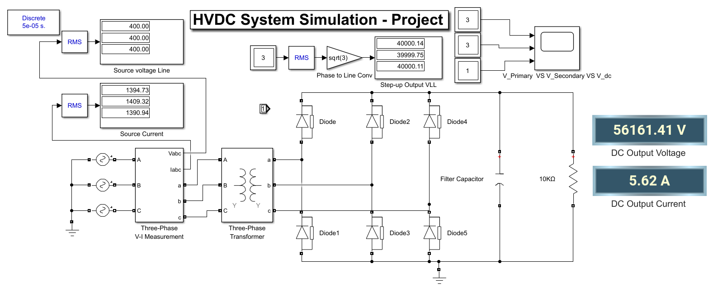
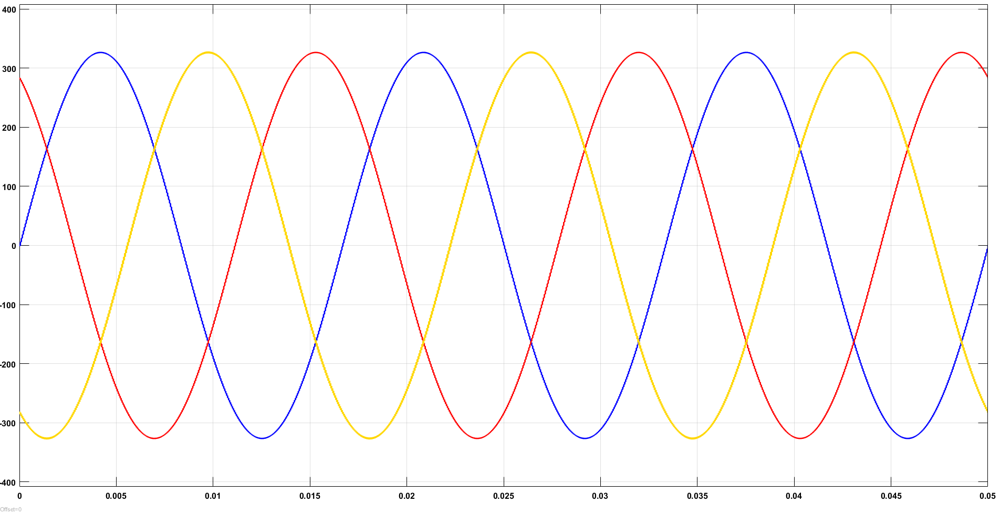
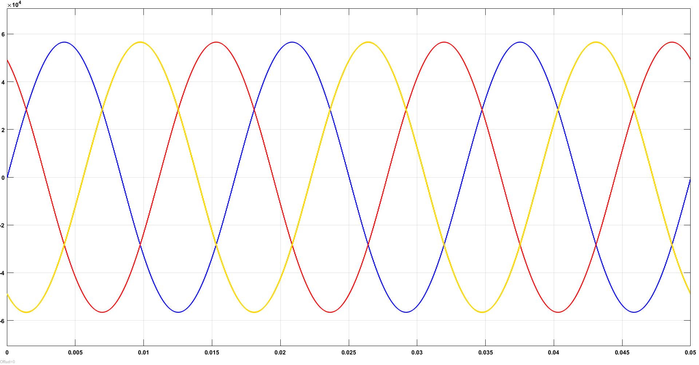
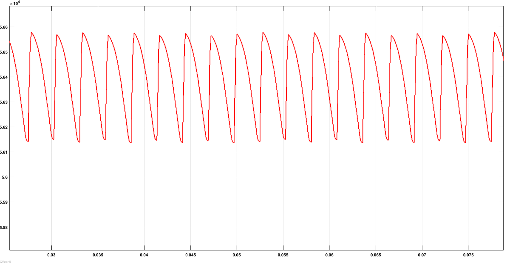

# High-Voltage DC (HVDC) Generation Using MATLAB/Simulink

### Three-Phase AC Source → Step-Up Transformer → Six-Pulse Diode Rectifier → Capacitor Filter → DC Load

A group project developed for the **High Voltage Engineering** course, Department of Electrical Engineering, **Taif University (2026)**.

**Project team**
- **Turki Abdulrahman Al-Zahrani**
- **Sattam Turki Al-Otaibi**
- **Khalid Muteb Alhulayfi**
- **Abdulrahman Abdullah Alosaimi**

We worked together on the HVDC generation simulation and its academic study. The project focuses on how a low-voltage three-phase AC source can be stepped up and converted into high-voltage DC in **MATLAB/Simulink**.

> **Educational simulation only.** This repository contains a simulated HVDC *generation/rectification stage*, not a full end-to-end HVDC transmission link or a construction-ready high-voltage power supply.

---

## 1. Project overview

High-voltage direct current (HVDC) is important in electrical engineering because high DC voltages are used in power systems, insulation-related engineering studies, and various high-voltage applications. Studying these systems in simulation helps explain the operating principles without constructing dangerous high-voltage hardware.

In this project, we designed a three-phase AC-to-DC conversion circuit using a transformer, a six-diode bridge rectifier, and a smoothing capacitor. The starting point is a **400 V line-to-line RMS, 60 Hz** three-phase source. A **Y–Y step-up transformer** raises the nominal line-to-line voltage to **40 kV AC**. The diode bridge rectifies this three-phase voltage, while the capacitor is connected across a **10 kΩ resistive load** to reduce output ripple.

The latest supplied simulation screenshot displays an output of approximately **56.16 kV DC** and **5.62 A**. These are values displayed by the saved simulation, not independently verified hardware measurements.

### Project objectives

1. Build a three-phase high-voltage DC generation model in MATLAB/Simulink.
2. Increase the source voltage using a three-phase step-up transformer.
3. Study the operation of an uncontrolled, six-pulse diode rectifier.
4. Use a capacitor filter to reduce the rectified output voltage ripple.
5. Measure and compare source voltage, source current, stepped-up voltage, and DC output.
6. Discuss the engineering limitations and possible improvements to the model.

---

## 2. Complete Simulink circuit

*Figure 1. Complete HVDC generation simulation. The diagram includes the three-phase source, V-I measurement block, step-up transformer, six diodes, output filter capacitor, resistive load, and monitoring displays.*

### Main circuit components

| Component | Purpose |
|---|---|
| Three-phase AC sources | Supply the input alternating voltage |
| Three-Phase V-I Measurement | Monitor source voltages and currents |
| Three-phase Y–Y transformer | Step up the AC voltage before rectification |
| Six diodes | Form an uncontrolled, three-phase full-wave bridge rectifier |
| Filter capacitor | Smooth the DC voltage and reduce ripple |
| 10 kΩ resistor | Represent the DC load |
| RMS and display blocks | Show the measured electrical quantities |
| Scopes | Display the input, transformer, and rectified waveforms |
| Discrete powergui | Configure the Specialized Power Systems simulation |

The complete editable model is provided in **[HVDC_Simu.slx](HVDC_Simu.slx)**.

---

## 3. Circuit design and operating principle

### Stage 1 — Three-phase AC supply

The simulation starts with three AC phases separated by **120 electrical degrees**. In the supplied design, the input is set to **400 V line-to-line RMS** at **60 Hz**.

A three-phase system provides a suitable input for a six-pulse rectifier because the bridge can draw from different phase combinations over each AC cycle. The source's voltage and current are monitored using the V-I measurement and RMS blocks.

### Stage 2 — Voltage step-up

The three-phase transformer is configured with a **Y–Y connection** and a nominal voltage ratio of **1:100** (primary to secondary). Its purpose is to increase the input voltage from approximately 400 V to 40,000 V line-to-line RMS.

For the nominal voltages:

\`\`\`text
Transformer voltage ratio = 40,000 V / 400 V = 100
Secondary voltage ≈ 100 × Primary voltage
Secondary voltage ≈ 40,000 V RMS (line-to-line)
\`\`\`

This stage produces the high-voltage AC input required for the rectifier.

### Stage 3 — Three-phase diode bridge rectification

Six diodes form a **three-phase full-wave (six-pulse) rectifier**. During operation, the conducting diode pair changes as the three-phase voltages change. The bridge produces a unidirectional output with periodic ripple.

For an ideal bridge, the instantaneous DC-side rectified voltage is related to the difference between the highest and lowest instantaneous phase voltages:

\`\`\`text
v_dc(t) = max(v_a, v_b, v_c) − min(v_a, v_b, v_c)
\`\`\`

This expression describes an ideal uncontrolled bridge *before* accounting for capacitor filtering, diode drops, and other nonideal effects.

### Stage 4 — DC filter and load

A **20 µF capacitor** is connected in parallel with the **10 kΩ load**. The capacitor stores charge near the peaks of the rectified waveform and supplies the load between charging intervals. This reduces the ripple compared with an unfiltered bridge.

The resistor acts as a simple load for evaluating the resulting DC output voltage and current.

### Stage 5 — Measurement and monitoring

The model contains RMS measurements, numerical displays, and waveform scopes so the electrical behavior can be studied at different points in the circuit:

- Input three-phase voltage
- Input three-phase current
- Transformer secondary voltage
- Rectified DC output voltage and current
- AC and rectified output waveforms

---

## 4. Simulation configuration

The project model uses the following settings.

| Parameter | Configuration |
|---|---|
| Source type | Three-phase AC |
| Source line-to-line RMS voltage | 400 V |
| Source frequency | 60 Hz |
| Transformer connection | Y–Y |
| Nominal transformer voltage ratio | 1:100 |
| Nominal secondary line-to-line RMS voltage | 40,000 V |
| Transformer nominal power parameter in the saved model | 50 kVA |
| Rectification method | Uncontrolled, six-diode bridge |
| Filter capacitor | 20 µF |
| DC load resistance | 10,000 Ω (10 kΩ) |
| powergui mode | Discrete |
| Discrete sample time | 5e-5 s (50 µs) |
| Simulation stop time | 0.08 s |

> **Note about model ratings:** The saved model's 50 kVA transformer rating does not agree with the power implied by the displayed DC load values (see Section 7). Therefore, the model should be considered an educational example, not a validated physical design.

---

## 5. Simulation results

The following readings are taken directly from the **latest supplied screenshot of the Simulink model**. The project has not been rerun to generate new values for this README.

### 5.1 Input source voltage

The RMS voltage display shows the same nominal line-to-line voltage for the three measured quantities.

| Source voltage channel | RMS voltage |
|---|---:|
| Channel A | 400.00 V |
| Channel B | 400.00 V |
| Channel C | 400.00 V |

The input waveforms are approximately sinusoidal with a phase displacement characteristic of a three-phase AC system.

*Figure 2. Three-phase input AC voltage waveforms, reproduced from the original course report.*

### 5.2 Input source current

The source current RMS display in the latest circuit screenshot gives these values:

| Source current channel | RMS current |
|---|---:|
| Channel A | 1,394.73 A |
| Channel B | 1,409.32 A |
| Channel C | 1,390.94 A |

These currents are **reported simulation values**. Their magnitudes are very high for a practical 400 V system and require further model/rating checks. The difference between the displayed channels has not been analyzed in detail here.

### 5.3 Stepped-up AC voltage

After the transformer, the model displays approximately **40 kV RMS line-to-line**.

| Secondary voltage channel | RMS voltage |
|---|---:|
| Channel A | 40,000.14 V |
| Channel B | 39,999.75 V |
| Channel C | 40,000.11 V |

The close agreement among these readings is consistent with the intended nominal **400 V to 40 kV** step-up.

*Figure 3. Three-phase AC waveforms after the transformer, reproduced from the original course report.*

### 5.4 Rectified DC output

The latest screenshot shows the following DC-side readings.

| Output parameter | Displayed result |
|---|---:|
| **DC output voltage** | **56,161.41 V** |
| **DC output current** | **5.62 A** |
| Load resistance | 10 kΩ |

The result demonstrates the modeled conversion from stepped-up AC to a high-voltage unidirectional output.

*Figure 4. Rectified DC output waveform from the original course report, showing the periodic ripple characteristic of a three-phase bridge.*

### 5.5 Results from the original course report

An earlier recorded simulation capture in the academic report gave **approximately 56,571 V DC** and **5.66 A**. The more recent screenshot of the supplied model shows **56,161.41 V** and **5.62 A**.

| Recorded capture | Output DC voltage | Output DC current |
|---|---:|---:|
| Latest supplied circuit screenshot | 56,161.41 V | 5.62 A |
| Earlier course-report capture | Approximately 56,571 V | 5.66 A |

The two snapshots are documented separately because the exact reason for the difference has **not** been established. The waveform images in Figures 2–4 come from the **course report**, not from a new simulation run corresponding to the latest numerical screenshot.

---

## 6. Theoretical calculations and comparison

These basic equations help interpret the simulation. The calculations below are **ideal approximations** rather than independent validation of every Simulink component.

### 6.1 Transformer voltage ratio

\`\`\`text
Voltage ratio = 40,000 / 400 = 100
\`\`\`

The nominal secondary voltage is 100 times the primary line-to-line voltage.

### 6.2 Ideal peak line-to-line voltage

For a sinusoidal secondary line-to-line RMS voltage of 40 kV:

\`\`\`text
V_LL,peak = sqrt(2) × V_LL,RMS
          = sqrt(2) × 40,000
          ≈ 56,569 V
\`\`\`

The displayed filtered output (56,161.41 V) is near this ideal peak level, which is qualitatively consistent with a capacitor-filtered three-phase diode bridge.

### 6.3 Unfiltered six-pulse bridge average

For an ideal, uncontrolled three-phase bridge **without capacitor smoothing** and under the usual continuous-conduction assumption:

\`\`\`text
V_DC,average ≈ 1.35 × V_LL,RMS
             ≈ 1.35 × 40,000
             ≈ 54,000 V
\`\`\`

This **54 kV** reference describes the ideal *unfiltered* average. It is not the same measurement condition as a capacitor-filtered output, which can approach the peak line-to-line voltage.

### 6.4 Expected current through the load

Using Ohm's law and the most recent displayed DC voltage:

\`\`\`text
I_DC = V_DC / R
     = 56,161.41 / 10,000
     ≈ 5.616 A
\`\`\`

This agrees with the displayed **5.62 A**, after rounding.

### 6.5 Six-pulse ripple frequency

For a 60 Hz three-phase supply, the ideal six-pulse rectification ripple repeats six times per AC cycle:

\`\`\`text
f_ripple = 6 × f_source
         = 6 × 60
         = 360 Hz
\`\`\`

The capacitor reduces the ripple amplitude, but the available screenshots do not provide enough numerical information to calculate the exact ripple percentage.

### 6.6 DC load power

The output power implied by the latest DC voltage and the **10 kΩ** load is:

\`\`\`text
P_DC = V_DC² / R
     = (56,161.41)² / 10,000
     ≈ 315.4 kW
\`\`\`

This is an important **consistency check**, not proof that the model represents a physically feasible transformer. The calculated load demand is much greater than the transformer's recorded nominal power parameter of **50 kVA**. This mismatch must be resolved before making claims about efficiency, transformer loading, or physical feasibility.

---

## 7. Discussion

### What the simulation demonstrates

The model illustrates the general sequence used to obtain DC voltage from a three-phase AC source:

1. The 400 V three-phase source supplies the system.
2. The transformer increases the nominal voltage to 40 kV.
3. The diode bridge converts the high-voltage AC to a pulsating DC waveform.
4. The capacitor smooths the rectified voltage across the load.
5. The measurement blocks report high DC voltage and corresponding load current.

The source and secondary readings demonstrate the intended step-up ratio, while the DC voltage/current displays are consistent with Ohm's law for the chosen resistor.

### Strengths of the model

- The entire AC-to-DC conversion chain is visible in one Simulink schematic.
- Using a three-phase source and six diodes illustrates six-pulse rectification.
- The measurements and scope plots make it possible to compare several stages of the circuit.
- The output resistor allows a straightforward current check using Ohm's law.
- The capacitor provides a clear starting point for studying DC ripple filtering.

### Limitations and practical challenges

- **No adjustable rectifier control:** An uncontrolled diode bridge cannot regulate output voltage by changing a firing angle.
- **High transformer ratio:** A single 1:100 step-up stage at these voltages raises insulation and engineering challenges.
- **Power-rating inconsistency:** A reported DC load of about 315.4 kW conflicts with the 50 kVA nominal transformer parameter saved in the model.
- **Large source currents:** The displayed source currents are around 1.4 kA per channel and would be challenging to support in real equipment.
- **Incomplete real-world protections:** Detailed insulation coordination, thermal behavior, fault protection, switching transients, and other nonideal effects have not been validated for physical implementation.
- **Limited simulation duration:** The saved 0.08 s run is useful for illustrating waveforms but does not on its own demonstrate long-term stability.
- **Unquantified output ripple:** The waveform shows ripple, but a numerical ripple percentage is not established by the supplied records.

For these reasons, this is best presented as a **course-level concept demonstration**, rather than a ready-to-build HVDC source.

---

## 8. Possible future improvements

The original project discussion identified several ways to make the system more flexible or realistic:

1. **SCR-controlled rectifier:** Replace the uncontrolled diode bridge with thyristors (SCRs), and study output voltage control through the firing angle.
2. **Improved transformer design:** Explore different step-up arrangements or multiple stages, while accounting for realistic insulation and equipment ratings.
3. **Ripple investigation:** Change the filter capacitor and load values, then plot and measure output ripple.
4. **Consistent power ratings:** Correct the transformer model and investigate the difference between the nominal rating, source current, and load power.
5. **Protection modeling:** Add relevant overcurrent, fault, insulation, and protection considerations.
6. **Extended simulation tests:** Compare startup, steady-state, and different load conditions using consistent measurement methods.

These are **proposed improvements**, not features claimed to be implemented in the uploaded model.

---

## 9. How to run the simulation

### Requirements

- MATLAB and Simulink
- Simscape Electrical / **Specialized Power Systems** functionality compatible with the blocks in the saved model

The saved model metadata indicates **MATLAB R2023b**. Compatibility and block availability can differ across MATLAB releases.

### Steps

1. Download or clone this repository.
2. Locate **[HVDC_Simu.slx](HVDC_Simu.slx)**.
3. Open the model in MATLAB/Simulink.
4. Review the source, transformer, rectifier, filter, and solver settings.
5. Run the simulation and open the scopes to inspect the waveforms.
6. Compare the resulting RMS displays and DC output with the recorded results above.

You can also open and run the model from MATLAB, if the required toolboxes and blocks are available:

\`\`\`matlab
open_system('HVDC_Simu.slx');
sim('HVDC_Simu');
\`\`\`

**Note:** Model compatibility, numerical results, and behavior may differ by MATLAB version or simulation settings. The values shown in this README are the supplied recorded results; they are not guaranteed outputs on every system.

---

## 10. Repository structure

\`\`\`text
HVDC-Three-Phase-Rectifier-Simulink/
├── HVDC_Simu.slx
├── README.md
└── images/
    ├── hvdc-simulink-circuit.png
    ├── input-ac-waveforms.png
    ├── secondary-ac-waveforms.png
    └── rectified-dc-waveform.png
\`\`\`

Only the editable simulation model, its README, and the referenced images are included. The original course-report Word document and student identification numbers are intentionally not published.

---

## 11. Conclusion

In this project, **Turki Abdulrahman Al-Zahrani, Sattam Turki Al-Otaibi, Khalid Muteb Alhulayfi, and Abdulrahman Abdullah Alosaimi** worked together to model a high-voltage DC generation circuit in MATLAB/Simulink.

The circuit combines a **400 V, 60 Hz three-phase AC source**, a **1:100 Y–Y step-up transformer**, a **six-diode full-wave rectifier**, and a **capacitor-filtered 10 kΩ load**. The recorded simulation demonstrates approximately **40 kV RMS** at the transformer secondary and **56.16 kV DC at 5.62 A** at the output in the latest screenshot.

The study helped illustrate voltage step-up, three-phase rectification, output filtering, and electrical measurement in one model. It also identified important limitations—particularly the lack of output control and inconsistency between the recorded transformer power rating and load demand—that would need further investigation in a more realistic engineering design.

---

## 12. Academic context

**University:** Taif University  
**College:** College of Engineering  
**Department:** Electrical Engineering  
**Course:** High Voltage Engineering  
**Academic year:** 2026

**Group members:** Turki Abdulrahman Al-Zahrani; Sattam Turki Al-Otaibi; Khalid Muteb Alhulayfi; Abdulrahman Abdullah Alosaimi.

This repository documents a shared academic group project. No individual work-package assignments are asserted here because the report does not specify each student's separate responsibilities.
